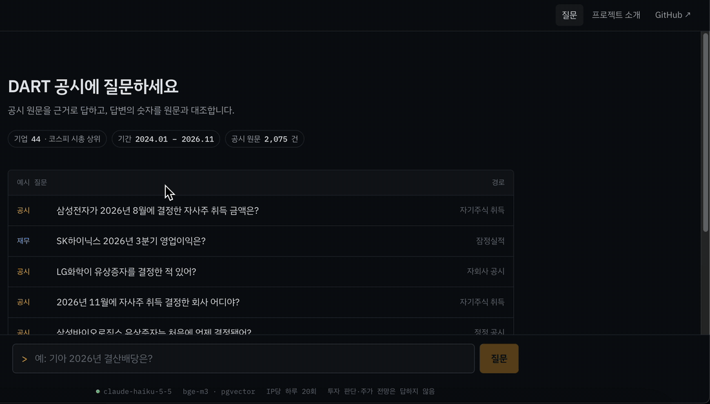
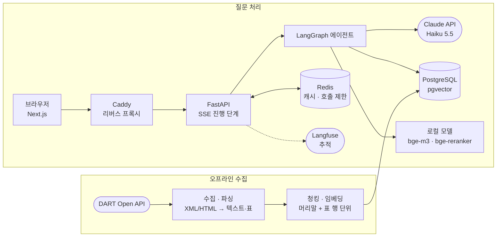
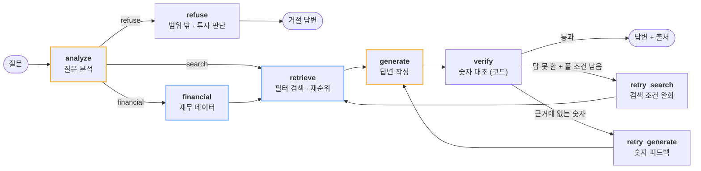
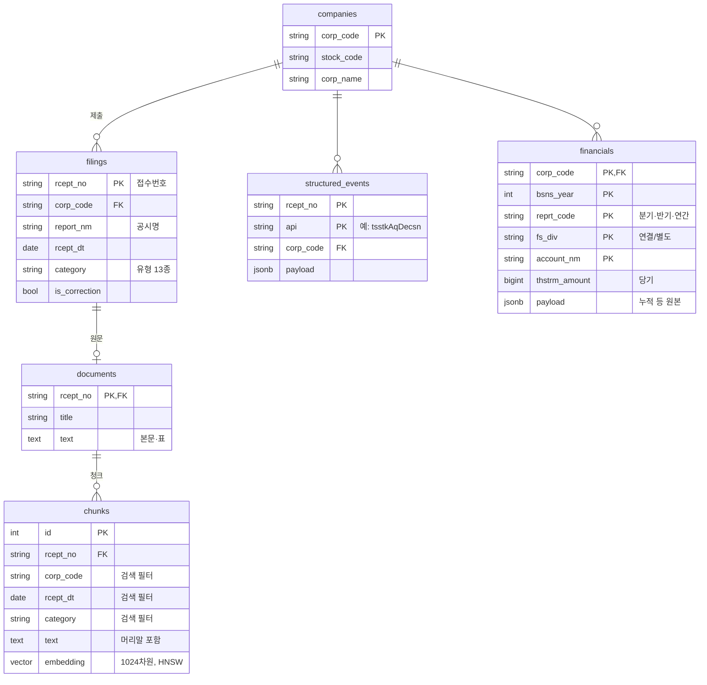

# DART 공시 리서치 에이전트

상장사 공시에 대한 질문에 **공시 원문을 근거로** 답하고, 답변에 쓴 숫자가 원문과 맞는지 **코드로 다시 검증**하는 LangGraph 기반 RAG 에이전트입니다.

> 코스피 시가총액 상위 44개 기업 · 2024년 이후 공시 21,644건 · 원문 2,075건 · 평가 질문 73개(직접 구축)



<sub>AWS EC2(서울)에 배포해 녹화한 화면입니다.</sub>

## 결과

- **정답률**: 정답을 직접 확인해 둔 질문에 대해 답변의 숫자·내용이 맞은 비율
- **환각**: 공시 원문에 없는 숫자를 답변에 쓴 비율
- **검색 1위 정답률 (hit@1)**: 검색 결과 1위가 정답이 들어 있는 공시인 비율. LLM 없이 검색만 따로 평가한 값

| 지표 | 기본 RAG | 이 에이전트 |
|---|---|---|
| 정답률 (개발 중에 보지 않은 질문 20개) | 55% | **80%** |
| 원문에 없는 숫자를 쓴 답변 (환각) | 15% | **0%** |
| 검색 1위 정답률 (hit@1) | 47% (머리말 없는 청크) | **70%** (머리말 + 표 열 이름 반복 + 재순위) |
| 같은 질문 응답 시간 | 27.7초 | **0.14초** (Redis 캐시) |

기본 RAG는 검색 상위 5개를 그대로 넣어 답하는 방식입니다. 정답은 DART 원문에서 직접 확인했고, 채점은 코드와 LLM(Claude Sonnet)이 함께 했습니다.

## 시스템 구성



외부로 나가는 호출은 Claude API뿐이고, 임베딩·재순위 모델은 서버에서 직접 돌립니다. 전체는 `docker compose up` 한 줄로 실행됩니다.

## 에이전트 내부 흐름



| 노드 | 하는 일 |
|---|---|
| `analyze` (Claude) | 회사·별칭, 공시 날짜 범위, 공시 유형, 회계 기간(분기/누적)을 JSON으로 뽑고 경로를 정한다 |
| `financial` | 재무 API 데이터에서 질문한 기간의 값을 고른다 (3개월치 vs 누적, 4분기 = 연간 − 3분기 누적) |
| `retrieve` | 회사·날짜·유형으로 좁혀 벡터 검색 → 재순위 → 공시 단위로 묶어 **공시 전체**를 근거로 넘긴다 |
| `generate` (Claude) | 근거에 있는 숫자만 써서 출처(접수번호)와 함께 답한다 |
| `verify` | 답변의 숫자를 원문과 하나씩 대조한다. 억·조 단위는 환산해 비교한다 |
| 재시도 | 최대 2회. 그래도 확인되지 않은 숫자가 남으면 답변 끝에 경고를 붙인다 |

## 해결한 문제

공시 데이터에는 단순 검색으로는 틀리기 쉬운 구조가 있었습니다.

| 문제 | 해결 |
|---|---|
| **제출한 회사 ≠ 결정한 회사**: 공시의 26%는 자회사의 결정을 모회사가 대신 낸 것 | 자회사 공시를 구분해 뒤로 미루고, 답변에 실제 결정한 회사를 밝히게 함 |
| **숫자가 나중에 바뀜**: 공시의 20%에 정정 공시가 따라옴 | 원래 공시 뒤 150일 안의 정정 공시를 함께 가져와 바뀐 숫자로 답함 |
| **분기 실적과 누적 실적이 섞임**: 같은 칸이 보고서마다 3개월치이거나 누적 | 질문한 기간에 맞는 값을 고르고, 4분기는 연간에서 3분기 누적을 빼서 계산 |
| **공시 하나가 여러 조각으로 잘림**: 원문의 77%가 여러 청크로 나뉨 | 검색은 청크 단위로, 답변에는 찾은 공시 전체를 넣음 (정답률 87% → 98%) |
| **표 조각만으로는 어느 회사 숫자인지 모름** | 청크 앞에 `[회사 \| 날짜 \| 공시명 \| 섹션]` 머리말 (검색 1위 정답률 47% → 62%) |

## 데이터 모델



## 기술 스택

| 역할 | 기술 | 쓴 이유 |
|---|---|---|
| 에이전트 | **LangGraph** | 분석 → 검색 → 작성 → 검증과 재시도 분기를 그래프로 명확히 표현 |
| LLM | **Claude Haiku 5.5** (채점은 Sonnet 5.5) | JSON 스키마 출력. Sonnet과 정답률 차이가 작아(3문항) 비용 절반인 Haiku 선택 |
| 임베딩 · 재순위 | **bge-m3**, **bge-reranker-v2-m3** | 한국어 성능, 로컬 실행으로 비용 0 |
| 벡터 DB | **PostgreSQL + pgvector** (HNSW) | 공시·재무 데이터와 벡터를 한 DB에서 필터와 함께 검색 |
| API | **FastAPI** | SSE로 진행 단계 스트리밍, Swagger 문서 |
| 캐시 · 제한 | **Redis** | 같은 질문 0.14초, IP당 하루 20회 제한, 장애 시 그대로 통과 |
| 관측 | **Langfuse** | 질문별 단계·토큰·비용 추적 |
| 화면 | **Next.js** | 채팅 UI, 숫자를 누르면 원문 줄 표시 |
| 인프라 | **Docker Compose**, **Caddy**, **GitHub Actions** | 한 줄 실행, HTTPS 프록시, CI(ruff·pytest 88개) |
| 배포 | **AWS EC2** (t3.large, 서울) | Ubuntu 24.04 + Docker, 80번 포트만 공개, DB는 덤프로 이전 |

## 빠른 실행

```bash
cp .env.example .env                  # DART_API_KEY, ANTHROPIC_API_KEY 입력
./scripts/db_restore.sh dart.dump     # 데이터 덤프 복원 (없으면 아래 '데이터 수집')
docker compose up -d --build          # → http://localhost
```

---

## 상세

### Docker 구성

```
caddy :80 ─┬─ /      → web  (Next.js standalone)
           └─ /api/* → api  (FastAPI + LangGraph + bge-m3 + 재순위) ─┬─ postgres (pgvector)
                                                                    └─ redis
```

- **이미지**: API 1.6GB, 웹 230MB. PyTorch는 리눅스에서 CPU 휠을 쓰도록 고정해(`[tool.uv.sources]`) CUDA 휠보다 수 GB 줄였다.
- **모델**: 이미지에 넣지 않고 `models` 볼륨에 받는다. 첫 시작 때 약 7분(6.9GB), 이후에는 볼륨에서 바로 읽는다. 서버가 뜬 뒤 백그라운드로 불러오므로 그동안에도 `/api/health`는 응답한다.
- **프록시(Caddy)**: 한 주소에서 화면과 API를 함께 제공해 CORS가 필요 없다. SSE 진행 단계는 버퍼링하지 않고 바로 흘려보낸다. `SITE_ADDRESS=도메인`을 주면 HTTPS 인증서를 자동으로 받는다.
- **보안**: API 키는 `.env`에서 실행 시점에만 주입하고 이미지에는 넣지 않는다(`.dockerignore`). Postgres·Redis 포트는 `127.0.0.1`에만 열어 서버 밖에서 접속할 수 없다.
- **데이터 옮기기**: `./scripts/db_dump.sh`로 로컬 DB를 35MB 파일 하나로 내보내고, 서버에서 `db_restore.sh`로 복원한다(실험용 청크 데이터는 제외).
- 로컬 CPU(Docker) 기준 새 질문 응답 약 25초, 그중 검색+재순위 약 17초.
- **EC2 배포** (t3.large, 2 vCPU · 8GB): Docker 설치 → `git clone` → `.env`와 덤프를 `scp`로 복사(DB 비밀번호는 서버에서 무작위 생성) → `db_restore.sh` → `docker compose up -d --build`. 보안 그룹은 SSH(내 IP)와 HTTP만 열었다. 모델 두 개를 올린 뒤 메모리 여유 5.7GB. 새 질문 응답은 GPU 없는 CPU라 15~55초이고 대부분 재순위 시간이다(정확도를 우선해 유지).

### 개발 환경

```bash
docker compose up -d postgres redis   # DB만 컨테이너로
uv sync                               # 의존성 설치
uv run pytest                         # 테스트
```

### 데이터 수집

```bash
uv run python -m app.ingest.collect all          # 전체 (다시 실행해도 안전)
uv run python -m app.ingest.collect documents    # 단계별 실행: filings / documents / structured / financials
```

| 수집 대상 | 범위 |
|---|---|
| 기업 | 코스피 시가총액 상위 40개 전체 + 4개 = 44개 ([data/companies.csv](data/companies.csv), 2026-11-18 종가 기준 고정, 보통주) |
| 기간 | 2024-01-01 ~ 현재 |
| 공시 목록 | 대상 기업의 전체 공시 메타데이터 |
| 공시 원문 | 자기주식 취득·처분, 유상·무상증자, 합병·분할, 타법인 주식 취득, 신규 시설 투자, 영업(잠정)실적, 배당, 주식 소각 |
| 구조화 데이터 | 주요사항보고서 핵심 필드 (숫자 검증의 정답지) |
| 재무 | 단일회사 주요계정 (분기·반기·연간) |

수집하면서 확인한 DART API의 특이점:
- `[첨부정정]` 공시는 본문 없이 첨부만 바뀐 것이라 원문(document.xml)이 없다 → 원문 수집에서 제외
- 요청이 몰리면 HTTP 200에 **빈 본문**을 보내는 경우가 있다 → 일시 오류로 보고 재시도
- 원문은 주요사항보고서는 DART 전용 XML, 거래소 공시는 HTML → lxml HTML 파서로 통일

### 검색 (RAG)

```bash
uv run python -m app.rag.index                                  # 청킹 + 임베딩 (bge-m3, 로컬)
uv run python -m app.rag.search "SK하이닉스 2026년 3분기 영업이익"   # 검색
```

- **청킹**: `##` 섹션 단위 → 길면 줄 단위로 약 1,000자씩. 표는 한 행이 한 줄이라 행 중간에서 잘리지 않는다.
- **머리말**: 각 청크 앞에 `[회사 | 날짜 | 공시명 | 섹션]`을 붙인다. 표 조각만으로는 어느 회사·어떤 공시의 숫자인지 알 수 없기 때문 (`--no-header`로 끄고 비교 실험 가능).
- **표 열 이름 반복**: 표가 여러 청크로 잘리면 뒤 조각 앞에도 열 이름 줄을 다시 붙인다 (`--no-table-header`로 끔).
- **재순위**: 에이전트는 필터 + 벡터 검색으로 후보를 최대 40개 가져와 `bge-reranker-v2-m3`(cross-encoder)로 다시 정렬한 뒤 상위만 쓴다. 목록 질문은 제외 (`RERANK=false`로 끔).
- **표지 제외**: 주소·전화번호만 있는 표지는 회사명 검색에 과하게 걸려 제외.
- **회사 필터**: 질문에서 회사명(별칭 포함)을 찾으면 `WHERE corp_code = ...`로 고정한 뒤 그 안에서 코사인 거리순 정렬. 벡터 검색은 '삼성전자'와 '삼성SDI'를 잘 구분하지 못한다.
- **인덱스**: pgvector HNSW (`vector_cosine_ops`).

### API (FastAPI)

```bash
docker compose up -d postgres redis               # DB만
uv run uvicorn app.api.main:app --port 8000       # http://127.0.0.1:8000/docs (Swagger)
```

| 메서드 | 경로 | 설명 |
|---|---|---|
| POST | `/ask` | 질문 → 에이전트. `stream: true`(기본)면 SSE로 진행 단계(`step`) → 답변·출처(`result`) → `done` |
| GET | `/companies` | 수집 대상 기업 44개 |
| GET | `/health` | 서버·DB·Redis 상태 |

```bash
curl -N -X POST 127.0.0.1:8000/ask -H 'Content-Type: application/json' \
  -d '{"question": "현대차 2026년 3분기 영업이익은?"}'
```

- **스트리밍**: 답변은 JSON 스키마로 한 번에 생성되므로 글자 단위 대신 실제 진행 단계(질문 분석 → 재무 데이터 조회 → 공시 검색 → 답변 작성 → 숫자 검증)를 실시간으로 보낸다.
- **캐시 (Redis)**: 공백·물음표를 정리한 질문 + 모델 + 에이전트 버전으로 키를 만든다. 같은 질문은 27.7초 → 0.14초, API 비용 0원. 7일 보관.
- **호출 제한 (Redis)**: IP당 하루 20회, 전체 하루 500회 (캐시 응답은 세지 않음). 초과 시 429.
- Redis가 꺼져도 캐시·제한 없이 동작(fail-open).

### 관측 (Langfuse)

`.env`에 `LANGFUSE_PUBLIC_KEY`·`LANGFUSE_SECRET_KEY`·`LANGFUSE_HOST`가 있으면 질문마다 추적이 남는다(없으면 꺼짐).

```
dart-agent (질문·답변·비용·흐름)
 ├─ analyze  └─ claude:Analysis   (모델·입출력·토큰·비용)
 ├─ financial / retrieve           (재무 데이터, 고른 공시)
 ├─ generate └─ claude:AnswerOut
 └─ verify   → 실패 시 generate·verify가 한 번 더 (재시도가 그대로 보임)
```

- 스트리밍 응답은 단계마다 다른 스레드에서 실행될 수 있어, 최상위 추적 ID를 에이전트 상태로 노드에 넘긴다.
- Anthropic SDK의 자체 OpenTelemetry 기록은 보내지 않는다. 그대로 두면 같은 호출이 두 번 잡혀 비용이 두 배로 표시됐다(실측 $0.0027 → $0.0050).
- 출처를 metadata(`source`: api / cli / eval)로 구분한다.

### 화면 (Next.js)

```bash
cd web && npm install && npm run dev        # http://localhost:3000  (API 서버가 8000번에서 돌고 있어야 함)
```

- **`/` 채팅**: 예시 질문 또는 직접 질문 → 진행 단계 로그(단계별 소요 시간) → 답변 → 출처(DART 원문 링크).
- **숫자 → 원문 줄**: 답변에서 확인된 숫자를 누르면 그 숫자가 나온 공시 원문의 줄을 보여준다(숫자 검증 노드가 찾은 짝).
- **`/about` 프로젝트 소개**: 결과, 시스템 구성도, 에이전트 흐름도(LangGraph), 해결한 문제, 검색 실험, ERD. 다이어그램은 인라인 SVG.
- 디자인: 다크 리서치 터미널. IBM Plex Sans KR + IBM Plex Mono(숫자·로그), 강조색은 앰버 하나.
- API 서버는 시작할 때 임베딩 모델을 백그라운드로 미리 불러온다(안 하면 첫 질문이 약 20초 더 걸림).

### 평가

```bash
uv run python -m eval.retrieval --label xxx                # 검색 평가 (무료)
uv run python -m eval.answers --model haiku --label xxx    # 답변 생성 + 채점
uv run python -m eval.answers --set test --label final     # test 세트: 전체 점수만 출력
```

- **평가셋**: dev 53문항(개발 중 참고) + test 20문항(보지 않는 세트, 최종 보고용). 정답 숫자는 DART 구조화 API·재무 API·원문 표에서 확인. 유형: 사실 조회, 재무 수치, 목록, 비교, 요약, 함정(날짜·정정·자회사 공시·연결/별도·회계연도), 거절.
- **채점**: 코드 채점(핵심 숫자 포함, 출처 적중) + LLM 채점(Claude Sonnet 고정: 정답/부분/오답, 환각).
- **채점기 검증**: 사람이 정의한 판정 기준 4개로 15문항 교차 채점 → LLM 채점과 15/15 일치. 이 과정에서 정답지 오류 2건(정정 후 금액, 분기 vs 누적 영업이익)과 날짜 비교 버그를 찾아 수정.

#### 실험 기록

| # | 바꾼 것 | 결과 (dev) | 결론 |
|---|---|---|---|
| 0 | 답변 모델: Haiku 5.5 vs Sonnet 5.5 | 정답률 62% vs 68% (53문항 중 3개 차이) | 두 모델이 모두 틀린 7문항은 전부 **검색 실패**. 실험 모델은 Haiku로 고정(비용 약 절반) |
| 기준선 | 기본 RAG (검색 상위 5개 → 답변) | 검색 hit@1 62%, MRR 0.72 / 답변 정답률 62% (Haiku) | 날짜·공시 종류 무시, 회사명 없는 질문, 회계연도≠공시일에서 실패 |
| 1 | LangGraph 에이전트 v1: 질문 분석(회사·공시일·유형·회계기간) → 필터 검색/재무 데이터 → 답변 → 숫자 검증 → 재시도 | 정답률 62% → **87%**, 출처 적중 83% → 98%, 과잉 거절 20% → 2%, 환각 0% | 재무·비교 질문 100%. 남은 실패는 대부분 '맞는 공시의 일부 조각만 봄' |
| 2 | 에이전트 v2: 청크 대신 공시 전체를 근거로(분량 예산을 공시 수로 배분), 목록은 공시별 중복 제거, 자회사 공시 후순위, 이후 정정 공시 따라가기 | 정답률 87% → **98%**, 출처 적중 100%, 과잉 거절 0% | v1 실패 7개 모두 해결, 요약 1개 흔들림. dev는 포화 → 이후 판단은 test로 |
| 2a | 제거 실험: 질문 분석 프롬프트에서 dev 질문을 베낀 예시(삼전·하닉, 날짜 문구)를 중립 예시로 교체 | 겹쳤던 4문항 모두 여전히 정답 | 개선은 예시에 답을 넣은 과적합이 아니라 일반화된 결과. 이후 프롬프트에 dev·test 문구가 없는지 코드로 확인 |
| 3 | 검색 비교 실험: 청크 머리말, 잘린 표의 열 이름 반복, 재순위(bge-reranker-v2-m3) | 아래 표 | 머리말 유지, 열 이름 반복과 재순위 적용 (C+R) |
| 4 | 3번 적용(v3): 열 이름 반복 인덱스 + 재순위. 목록 질문은 재순위 없이 후보 청크 40 → 80개 | dev 정답률 94~96% (2회), 환각 0%, 함정·재무·사실·비교 100% | v2(98%)와 1~2문항 차이. 요약 2문항은 v2와 **같은 근거**에서 답이 흔들렸고, 목록 1문항은 세부 날짜 누락. 답변 수준의 개선은 확인되지 않았고, 검색 지표 개선과 정확도 우선 판단으로 유지 |

##### 3번 실험: 검색 비교 (dev 53문항, 검색만, LLM 비용 없음)

```bash
./scripts/overnight.sh     # 재인덱싱 + 평가 전체. 중간에 멈춰도 다시 실행하면 이어서 한다
```

| 버전 | 바꾼 것 | hit@1 | hit@3 | hit@5 | MRR | 함정 hit@1 | 질문당 시간 |
|---|---|---|---|---|---|---|---|
| A | 머리말 `[회사 \| 날짜 \| 공시명 \| 섹션]` 있음 | 0.62 | 0.81 | 0.89 | 0.73 | 0.60 | 0.08초 |
| B | 머리말 없음 | **0.47** | 0.60 | 0.62 | 0.54 | 0.50 | 0.08초 |
| C | A + 잘린 표 조각에 열 이름 반복 | 0.64 | 0.81 | 0.91 | 0.75 | 0.70 | 0.08초 |
| A+R20 | A + 재순위 (후보 20개) | 0.66 | 0.85 | 0.87 | 0.75 | 0.60 | 9.0초 |
| A+R | A + 재순위 (후보 40개) | 0.68 | 0.85 | 0.87 | 0.76 | 0.60 | 22.6초 |
| **C+R (현재)** | C + 재순위 (후보 40개) | 0.70 | 0.85 | 0.87 | 0.78 | 0.70 | 27.0초 |

- **머리말은 필수**: 빼면 hit@1 −15%p, hit@5 −27%p. 표 조각만으로는 어느 회사·어떤 공시의 숫자인지 알 수 없다는 가설이 확인됨.
- **표 열 이름 반복(C) 적용**: hit@1 +2%p, 함정 +10%p는 1문항 차이라 효과를 단정할 수는 없지만, 검색 시간이 같고 나빠진 지표가 없어 적용했다.
- **재순위 적용**: hit@1 0.64 → 0.70, MRR 0.75 → 0.78. 대신 맥 GPU 기준 질문당 최대 약 25초가 는다(에이전트는 필터로 후보가 줄어 대개 이보다 짧다). 공시 리서치 도구는 속도보다 정확도가 중요하다고 보고 적용했다. 실제 에이전트는 회사·날짜·공시 유형 필터로 후보가 먼저 줄어, 예시 질문 9개의 응답이 2~24초로 적용 전과 비슷했다. 실서비스(GPU 없는 서버)라면 후보 수 축소, GPU 서버, 더 작은 재순위 모델을 검토한다.
- **목록 질문은 재순위하지 않음**: 적용 후 dev 답변 평가에서 재순위가 다른 회사의 비슷한 공시를 위로 올려 목록에서 한 회사가 빠졌다. 재순위는 1위를 고르는 데 강하고, 목록은 빠짐없이 모으는 게 중요하다. 같은 문항을 보며 후보 40개 안에 해당 회사 공시가 아예 없던 것도 확인해, 목록 질문은 후보를 80개로 넓혔다.
- 적용 결과는 위 표의 4번.
- test 세트로는 확인하지 않았다. dev 답변 정답률이 이미 98%라 답변 수준의 이득은 측정하기 어렵고, test 점수를 보고 적용 여부를 정하면 test를 떼어 둔 의미가 없어지기 때문이다.

#### test 세트 사용 기록 (보지 않는 세트 · 전체 점수만 확인)

| 회차 | 날짜 | 시스템 | 정답률 | 비고 |
|---|---|---|---|---|
| 1 | 2026-11-20 | 에이전트 v2 (Haiku) | **80%** (16/20), 환각 0% | 첫 사용. dev 98%와의 차이 18%p는 dev에 맞춰진 정도와 test 문항의 난도를 함께 반영 |
| 2 | 2026-11-20 | 기본 RAG (Haiku) | 55% (11/20), 환각 15% | 같은 test에서의 비교 기준. 시스템 수정에는 쓰지 않음 |

**같은 보지 않는 세트에서: 기본 RAG 55% → 에이전트 80% (+25%p), 환각 15% → 0%.**

v2의 변경이 일반적인지 데이터로 확인: 공시 77%가 여러 청크로 나뉘고, 26%가 자회사 공시, 20%가 정정 공시다(특정 문항이 아니라 데이터 전반의 구조를 다룬 변경).
